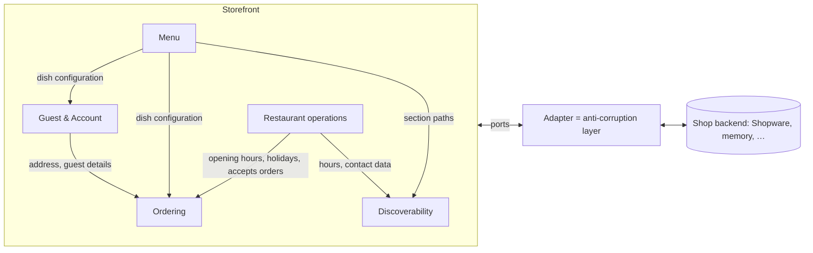

# 0001: Backend-agnostic storefront (ports and adapters behind a BFF)

## Context

The storefront is welded to Shopware. At 2.6.0 about 117 of 208 source files depend on it: `#shopware` types, the `@shopware/composables` layer and its auto-imported composables, `@shopware/api-client`, the generated `api-types`. 18 files call the Store API straight from the browser, and the server routes pass raw Shopware shapes (products, line items, SEO URLs) on to the app. A restaurant that runs another backend cannot use the storefront, and every Shopware upgrade reaches into components.

The storefront has its own rules that have nothing to do with Shopware: a dish with extras and removed ingredients is one cart line; wished times lie on a 5-minute grid within the opening hours, after the lead time of the chosen shipping method; holidays close the restaurant. Today these rules are spread over composables and depend on Shopware's data model.

## Decision

**The storefront works against any shop backend. Shopware becomes one adapter.**

### Backend for frontend

The browser talks only to the storefront's own Nitro routes (`/api/...`). No Store API call, access key or backend shape reaches the browser. The routes answer in the storefront's domain types (`shared/domain`).

The storefront keeps its own session in an HttpOnly cookie. Whatever a backend needs to recognise a visitor (Shopware's `sw-context-token`, a Sylius cart token and JWT) travels in that cookie sealed (encrypted and authenticated with the shop's password), so the browser can neither read nor change it, and is read and written only by the adapter, through `BackendSession` (`server/ports/session.ts`). Built in step 4 (see Progress).

### Ports and adapters

Ports are TypeScript interfaces in `server/ports/`, cut along ShopBite's language ([GLOSSARY.md](../../GLOSSARY.md)), not Shopware's:

| Port             | Context               | What it answers                                                        |
| ---------------- | --------------------- | ---------------------------------------------------------------------- |
| `CatalogPort`    | Menu                  | menu sections, dishes, variants, extras, search, top sellers, upsell   |
| `NavigationPort` | Discoverability       | navigations, breadcrumbs, path resolution with redirects, sitemap      |
| `CartPort`       | Ordering              | the cart, one line per dish configuration, vouchers                    |
| `CheckoutPort`   | Ordering              | shipping and payment methods, guest details, placing orders, payment   |
| `OrderPort`      | Ordering              | placed orders with the storefront's own order and payment status       |
| `CustomerPort`   | Guest & Account       | login, registration, profile, addresses, countries                     |
| `WishlistPort`   | Guest & Account       | the customer's wishlist of dish configurations                         |
| `ShopPort`       | Restaurant operations | configuration, opening hours, holidays, branches                       |
| `ContactPort`    | Restaurant operations | contact messages                                                       |

The ports live on the server because only the server talks to a backend and holds the session. The domain types live in `shared/domain/` so the app can type the BFF answers with them.

Two adapters in `server/adapters/`:

- `shopware`: today's behaviour over the Store API and the ShopBite plugin.
- `memory`: the whole backend in process memory, seeded with the quickstart's demo restaurant. It proves that the ports can be served without Shopware and backs the contract tests.

Runtime config `shopBite.backend` (`NUXT_SHOP_BITE_BACKEND`, default `shopware`) selects the adapter; server routes reach it with `useBackend(event)` (`server/utils/backend.ts`), one instance per process. Ports an adapter does not have yet reject with the domain error `not_implemented`.

Each port gets a contract suite in `test/contract/` that runs against every adapter (`runContract`). A suite describes a scenario in domain terms; each adapter fixture builds a backend holding it (the memory adapter from its seed, the Shopware adapter from a fake Store API answering Shopware JSON). Adapter-specific edge cases (what Shopware sends that the domain cannot express) are unit tests next to the adapter.

Caching, backoff and the resilient loaders stay in the server routes around the port calls, not in the adapters, so every adapter gets them and a contract test sees the adapter's own behaviour.

### Bounded contexts and context map

- **Menu**: what the restaurant offers.
- **Ordering**: cart, checkout, delivery or pickup, orders.
- **Guest & Account**: who orders; guests, customers, addresses, wishlist.
- **Restaurant operations**: opening hours, holidays, store status, branches, the switch that accepts orders, contact.
- **Discoverability**: paths, navigations, SEO, sitemap, `llms.txt`.
- **Shared kernel** (`shared/domain/kernel`): `Money`, `Media`, `TimeOfDay`, `CalendarDate`, `TimeZone`, `Weekday`, `Id`, `DomainError`.

Upstream contexts publish their types; downstream contexts use them as they are (customer/supplier inside one codebase). Every adapter is an anti-corruption layer: it translates the backend's model into the domain types in both directions, and no backend word passes it (the glossary lists the Shopware words that must not leak). The storefront's Markdown content pages are not a backend matter and stay outside the ports.

### Scope of DDD

- **Strategic DDD in full**: the glossary, the contexts, the context map, an anti-corruption layer per adapter.
- **Tactical DDD where the storefront owns the rule**: value objects as immutable types with validating constructors (`money`, `timeOfDay`, `calendarDate`, `timeZone`, `leadTime`, `wishedTime`, `openingInterval`, `holiday`, `dishConfiguration`), domain services as pure functions (e.g. `earliestWishedTime`; the ordering window and store status follow when their logic moves), domain errors with codes (`DomainError`).
- **Not** repositories or aggregates with persistence: the backend owns the state, ports are gateways that answer with the backend's result (a cart port returns the cart the backend calculated). **Not** domain events across contexts: the contexts share one process and call each other's pure functions.

Within this frame:

- IDs are opaque strings. Money is integer minor units with an ISO 4217 code; the number of minor digits comes from the currency (EUR 2, JPY 0, KWD 3, `Intl.NumberFormat`), decimals round half away from zero, and there is no negative zero (Sylius stores minor units; Shopware's decimals are converted at the adapter).
- Countries are ISO 3166-1 alpha-2 codes; the Shopware adapter maps them to country ids.
- **Time** belongs to the restaurant, not to the server or the browser: `ShopConfig.timeZone` (IANA). The ShopBite plugin decides in the sales channel's business time zone, else Europe/Berlin, but does not report it, so the Shopware adapter takes runtime config `shopBite.timeZone` (default `Europe/Berlin`). Dates and wall-clock times of an instant are read in that zone (`zonedDateTime`), also across DST switches.
- Times of day are minutes since midnight. An opening interval never crosses midnight and may close at 24:00 (1440, the end of the day); a late-night opening is two intervals. The Shopware adapter maps plugin rows by the plugin's rule: a closing time at or before the opening time runs into the next day and is split at midnight, closing at 00:00 or 24:00 is the end of the day. Rows it cannot read are logged and dropped.
- Holidays are whole days (`firstDay`, `lastDay`, both included) in the restaurant's time zone.
- A wished time is a service date plus a time on the 5-minute grid, so an order before midnight can be wished for after it. `earliestWishedTime` looks at today's and tomorrow's opening intervals and holidays, at most 24 hours ahead. It is a field of `Order` and `PlaceOrderCommand`; putting it into Shopware's customer comment ("Wunschlieferzeit: 18:40") is the Shopware adapter's job.
- A cart has discounts, each with the voucher code it came from or none (an automatic discount).
- Adapters answer frozen values and build themselves from the runtime config (`shopwareFromRuntimeConfig`, `memoryFromRuntimeConfig`); the registry only picks one by name.
- Building a `srcset` from `Media` is presentation and lives in app utils, not in the domain.
- Visitor-specific ports take a `BackendSession`; shop-wide ports (catalog, navigation, shop, contact) take none, so their answers can be cached across visitors.
- The app imports types only from `shared/domain` for now: a value import of `shared/` from app code broke the Nitro server bundle of shops in 2.0.1. The first step that needs a value object in the app checks it with the layer build (`pnpm nuxt build test/layer`) first.

### Migration

Each step moves one area behind its port, keeps the shop working, and ships as a 2.x minor. Within a step, the old route or composable is replaced, not duplicated.

Before and after are compared against the quickstart on every page type the step touches, the menu root included: status, redirect, the whole `<head>` (title, canonical, description, og/twitter), JSON-LD and visible text, plus a cache purge after a rename in the Admin and, from step 4 on, the normalised Store API cart. Any difference is either fixed or listed under the step's allowed behaviour changes.

| Step | Area                                                                                                         | Release |
| ---- | ------------------------------------------------------------------------------------------------------------ | ------- |
| 0    | Glossary, this ADR, domain types and value objects, port interfaces, adapter registry, contract harness, lint guard; no behaviour change | 2.x minor |
| 1    | Restaurant operations: `ShopPort` (config, hours, holidays, branches) behind the BFF, live checkout switch through the BFF | 2.x minor |
| 2    | Menu: `CatalogPort` (sections, dishes, variants, extras, search, top sellers); memory adapter gets the demo menu | 2.x minor |
| 3    | Discoverability: `NavigationPort` (navigations, path resolution and redirects, sitemap, `llms.txt`)          | 2.x minor |
| 4    | Storefront session (HttpOnly cookie, backend state sealed in it) and `CartPort`                               | 2.x minor |
| 5    | Checkout and orders: `CheckoutPort`, `OrderPort` (wished time, guest details, payment)                        | 2.x minor |
| 6    | Guest & Account: `CustomerPort` (login, registration, profile, addresses)                                    | 2.x minor |
| 7    | `WishlistPort`, `ContactPort`; no browser-direct backend call left                                           | 2.x minor |
| 8    | Remove `@shopware/nuxt-module`, the `@shopware/composables` layer and the Shopware helpers outside the adapter; the lint guard becomes an error | 3.0.0 |

### Progress

**Step 1 (restaurant operations), done.** `ShopPort` and `CheckoutPort.listShippingMethods` behind the BFF: `GET /api/shop/config`, `/api/shop/opening-hours`, `/api/shop/holidays`, `/api/shop/branches`, `/api/checkout/shipping-methods` answer domain types; they replace `/api/shopbite/config`, `/business-hours` and `/holidays`. Each is cached for server-side rendering and `llms.txt` (`server/utils/shopData.ts`, `swr: false`, resilient loader, emptied by every purge and by `{ "layout": true }`); `?fresh=1` asks the port directly (no cache, no last good answer) for the browser's live values and for the check of the switch that accepts orders right before an order. `DomainError`s become HTTP answers in one place (`server/utils/domainHttp.ts`). The browser asks no Store API for configuration, hours, holidays, branches, lead times or the menu root (`/api/menu/root`). Store status, opening hours displays, the wished time choice, the Restaurant schema and `llms.txt` work in the restaurant's time zone, and a late-night opening reads and counts as one span (Fri 17:00–01:30). Lint guard: 105 warnings (111 at step 0).

Deviations and open points of step 1:

- The app does not use the domain's value objects and services (`earliestWishedTime`): a value import from `shared/` is still avoided in app code. `app/utils/restaurantTime.ts` computes store status and the wished time window on the domain types; it moves onto the domain services together with the ordering window.
- Ordering window vs. plugin (note below): settled for now on the plugin's side. The wished time stays within today's spans plus yesterday's late-night span, never on a holiday, and no pre-order for a later service day is offered. A late-night opening that started on a holiday is not continued after midnight (the display joins the split intervals and keeps their origin day). DST slots are not treated specially (wall-clock minutes). A span up to 24:00 offers wished times up to 23:55.
- Lead times are loaded live once after hydration (`useLiveShopData`); only the switch that accepts orders is refreshed every 10 s in the checkout. The Shopware adapter needs two Store API requests for them (plugin config and `/shipping-method` names); concurrent reads of the plugin config share one request. A fresh request fails fast while the backend is paused after a failure. The ShopBite plugin refuses a paused order itself; the storefront's check before an order is defence in depth.
- The menu root still comes from the Shopware plugin config on the server (`shopbite-config`, a second cache of `/shopbite/config` next to `shop-config`) until `NavigationPort` (step 3; now the domain value `menu-root`).
- Behaviour changes allowed by the step: holidays are whole days in the restaurant's time zone (the Restaurant schema and `llms.txt` took the UTC date of the plugin's instants before); an interval up to the end of the day reads `24:00` instead of `00:00` (schema.org keeps `00:00`, a day open around the clock is `00:00`–`23:59`).

**Step 2 (menu), done.** `CatalogPort` in both adapters with a contract suite (sections, listings with sorting, diet filters and pages, search, every dish for `llms.txt`, the dish sheet with variants, extras and removable ingredients, a dish or variant by menu number, a variant by options, top sellers, upsell dishes). The BFF answers domain types: `GET /api/listing/[sectionId]`, `/api/search`, `/api/top-sellers` (paths kept), `/api/menu/sections/[sectionId]`, `/api/menu/dishes/[dishId]`, `/api/menu/dishes?number=`, `/api/menu/dishes/[dishId]/variant`, `/api/menu/upsell`; they replace `/api/product/*` and `/api/category/[categoryId]`, and the browser asks no Store API for dishes any more (dish sheet by number, upsell, wishlist). Every route is a cached handler keyed by the section or dish id, so the backoffice purge keeps working; a dish sheet carries its extras, so every menu purge empties all dish sheets. The memory adapter serves the quickstart's demo menu with the ids its setup gives the Shopware entities. `llms.txt` takes the menu from the port. Components and composables of the menu work on the domain types; the app still imports types only (`app/utils/money.ts` and `app/utils/dish.ts` instead of the domain's value objects). Lint guard: 55 warnings.

Domain decisions of step 2:

- `Dish.path` is the dish's link when the backend keeps one (Shopware: the product SEO URL with `?produkt=`), else null and the storefront links the dish under the section it is listed in. Section paths stay `MenuSection.path`; resolving paths is step 3.
- `DishDetail` is always the dish; a variant asked for by id or number answers its dish with `selectedVariantId`. Without a request for one, `selectedVariantId` is the backend's default variant (Shopware's detail route answers a parent with it). `Variant` has its own name, media and main ingredients, inherited from the dish when it has none.
- Main ingredients carry ids (`Ingredient`); removals are still written by name (dish sheet URL `ohne`, cart payload `without`, wishlist), as before.
- `Extra.available` and `Dish.listPrice`/`Variant.listPrice` are mapped; the UI does not use them yet.
- `findVariant` with fewer options than groups answers the first variant that has them (Shopware's `/product` filter); with one option per group exactly that variant.
- Food labels belong to every `Dish`, so the sheet's info button works before the sheet's own data are loaded.
- `MenuSection.seo` (title, description, indexable) carries what the section page's SEO needs; a section off the menu keeps its page as not indexable.

Behaviour changes allowed by the step (otherwise identical, compared on SSR HTML, JSON-LD and visible text against the quickstart):

- The removable ingredients of the dish sheet are in the order of the menu card (the sheet listed them in the backend's order of assignment before).
- Search results know a parent with variants: "ab" price and the choice button instead of adding the parent, which the cart silently left out.
- A dish sheet opened by a variant's number (deep link, wishlist) shows the dish's description, diets and food labels.

For shops that extend the layer (release notes; breaking only for overrides and own uses):

- Removed routes: `/api/product/[productId]`, `/api/product/[productId]/cross-selling`, `/api/product/variant`, `/api/category/[categoryId]`. `/api/listing/[sectionId]`, `/api/search` and `/api/top-sellers` keep their paths but answer `MenuListing`/`Dish[]`; the listing's `properties` parameter is `filters`, `manufacturer` and `query` are gone.
- Removed composables and utils: `useCategoryById` (now `useMenuSection`), `useProductConfigurator`, `useProductVariantsZwei`, `useProductVariants`, `useProductCrossSelling`, `app/utils/product.ts` (`getMainIngredients`, `getDiets`, `getFoodLabels`, `allergensChecked`, `productIsAvailable`, `productNeedsChoice`, `lineItemHoldsProduct`; now `Dish` fields and `app/utils/dish.ts`), `productDeepLink` (now `dishLink`), `findCategory`, `types/Association`. A shop's own `useProductConfigurator` no longer shadows a project composable; the layer's original is auto-imported again.
- Changed props and returns: `MenuBonCard` `product` → `dish` (emits `select` with the dish), `ProductQuickView` `product` → `dish`, `ProductDetail` `productId` → `dishId`, `ProductConfigurator` takes `dishId`, `groups`, `selectedOptionIds`, `ProductDeselectIngredient` `product` → `ingredients`, `ProductCrossSelling` `associations` → `groups`, `ProductFoodLabels` `product` → `labels`, `MenuSectionHeader` `category` → `section`, `CategoryFilterGroup` takes a `ListingFilter`; `useProductQuickView` returns `dish` instead of `product`; `useAddToCart` has `setSelectedDish`/`setSelectedExtras`/`setRemovedIngredients` (`selectedDish`, `removedIngredients`); `useCartUpsell` has `loadUpsellDishes`/`addUpsellDish`; `useCategoryListing` and `useListingSearch` return `dishes`, `sortings`, `currentSorting`, `filters`; `useProductEvents`' cart addition carries `dish`.

Open points for later steps:

- Step 3 (done): navigation trees, breadcrumbs, path resolution and the sitemap moved behind `NavigationPort`. The memory adapter's media URLs are relative (`/api/menu/media/…`).
- Step 4 (done): the cart moved behind `CartPort`; `DishConfiguration` names removals by ingredient id.
- A partial variant choice (one of two groups) silently takes the first matching variant while the other group stays unselected in the sheet, as before; the sheet could select the found variant's options or resolve locally from `DishDetail.variants`.
- An unavailable extra is still offered in the sheet.
- The wishlist loads one dish sheet per entry (cached per dish); a batch route would need a port method for several dishes.

**Step 3 (discoverability), done.** `NavigationPort` in both adapters with a contract suite (header, footer, menu and home navigation, the menu root, breadcrumbs, path resolution for sections, other spellings and former paths, unknown and hostile paths, content pages as no backend paths, sitemap entries, known paths). The BFF answers domain types: `GET /api/navigation/[kind]` (`NavigationNode[]`), `/api/breadcrumb/[sectionId]` (`BreadcrumbItem[]`), `/api/resolve-path?path=` (`{ route: ResolvedRoute | null }`), `/api/menu/root` and the sitemap source; they replace `/api/navigation/[type]`, `/api/breadcrumb/[categoryId]`, `/api/seo-url`, `/api/seo-url/known`, and the browser no longer asks the Store API for old SEO URLs. The Shopware adapter owns the SEO URLs (`seoPathInfo` and `pathInfo` lookups, technical URLs, canonical and former SEO URLs by `isCanonical` and `languageId`, the navigation roots, category types, `linkNewTab`, the icon custom field, the sitemap trees, the paged SEO paths); the memory adapter serves the quickstart's menu root, header, footer and paths, so menu root, sections, dish links, breadcrumbs, navigations, sitemap and `llms.txt` render without Shopware (cart and checkout still need it until steps 4 and 5). Caches and their guarantees are kept: navigations, breadcrumbs, path routes, known paths and the menu root are cached, purged with every target, bounded (one path route per canonical path, slash variant and technical URL, never per spelling, miss or former path), hostile and unknown paths get no lookup, outages back off. The app works on the domain types. Lint guard: 40 warnings.

Domain decisions of step 3:

- `NavigationNode.kind` has `group` for a footer column (Shopware folder, `path: null`); `external` means opens in a new tab (`linkNewTab`); `media` is filled for the home navigation only. Shopware link categories stay `link` (a link to another category, an external URL or a storefront path cannot be told apart).
- `NavigationPort.getMenuRootId()` is new: the menu root decides the cache key of the menu navigations, the root page's single list and `/api/menu/root`. It is strict; only the Shopware sitemap falls back to the navigation root, as before. `getNavigation(kind, menuRootId)` takes the root the BFF resolved (cached), so a key and its tree never name two roots and an outage of the plugin configuration keeps the last good root's menu.
- Handlers that answer domain types under the name a Shopware-shaped handler had (`listing`, `search`, `top-sellers`, `variant`, `navigation`, `breadcrumb`) carry a versioned key (`versionedKey()`, `server/utils/cacheKeys.ts`), so persistent cache storage never serves an old shape. `createResilientLoader` answers a pause as `backend_unavailable`, so every 503 of a BFF route carries `data.code`.
- Scanner paths: control characters and a leading `//` or `/\` are hostile; a technical URL gets one lookup; a backend path that would redirect to another host (`//host/`) is no route (`isSafeRedirectTarget`), in the adapter and again in the BFF.
- A redirect names its section (`ResolvedRoute.sectionId`), and every adapter answers with `routeTo()`: the BFF caches one target per lower-cased path and rebuilds the answer for the visited spelling. `toggleTrailingSlash()`, `isHostilePath()`, `pathKey()` and `mayBeKnownPath()` are pure domain rules; the collation-like `pathKey` is the loosest adapter lookup so far, which an adapter's `resolvePath` must not exceed for listed paths.
- `KnownPaths` is null when there are too many to list, and names `unlistedPrefixes` (Shopware's technical URLs), which resolve without being listed and are cached per entity.
- `SitemapEntry.image` carries the section's photo for the image sitemap.
- The two caches of the plugin configuration of step 1 are now two domain values: `shop-config` (`ShopConfig`) and `menu-root` (`Id`), both from the port; the raw `shopbite-config` cache is gone. Shopware still answers both from one `/shopbite/config` request each per TTL.

Behaviour, compared against the quickstart's Shopware before and after (92 paths: every section URL with case and slash variants, technical URLs, a renamed section's former URL, dish links, unknown, scanner and hostile paths, content pages, `sitemap.xml`, `robots.txt`, `llms.txt`; status, redirect target, title, canonical, meta, JSON-LD incl. `BreadcrumbList`, every navigation, home sections, dish links): identical. Changes allowed by the step: a toggled-slash spelling of a section path is cached too (one Store API lookup less per request); the breadcrumb route takes the backends' opaque ids (`idParam`) instead of 32 hex characters, so an id Shopware has no route for is a 404, not a 400; the home navigation and the menu navigation ask Shopware for the category `type` as well; client-side navigation resolves paths through the BFF like server-side rendering (the shortcut via the history state of Shopware links is gone).

For shops that extend the layer (release notes; breaking only for overrides and own uses):

- Removed routes: `/api/seo-url`, `/api/seo-url/known`; `/api/navigation/[type]` keeps its URLs (`/api/navigation/main` …) but answers `NavigationNode[]`; `/api/breadcrumb/[categoryId]` keeps its URL but answers `BreadcrumbItem[]` (`label`, `path` with the leading slash).
- Removed composables and utils: `useSeoUrlRoute` (now `useSectionRoute`, returns `sectionId`), `useNavigationSearch` (the layer's own composable of that name is auto-imported again), `app/utils/seoPath.ts` (`resolveSeoPath`), the Shopware media shape of `mediaSrcSet`/`mediaSize` (domain `Media` only); server utils `menuRootId`, `menuRootIdStrict`, `shopBiteConfig`, `findSeoUrl`, `knownSeoPaths`, `server/utils/seoPaths.ts`, `categoriesToSitemapUrls` (now `toSitemapUrls` of `SitemapEntry[]`).
- Changed returns: `useNavigation()`'s `mainNavigation`, `footerNavigation` and `menuCardNavigation` hold `NavigationNode[]` (the `…Menu` items keep their shape), `useHomeMenuCategories()` holds `NavigationNode[]` (`label`, `path`, `media`); the catch-all page no longer uses the layer's `useNavigationContext` and `useBreadcrumbs`. Cache names for purges of own tools: `path-route`, `known-paths`, `menu-root` replace `seo-url`, `seo-paths`, `shopbite-config`.

Open points of step 3:

- `menu` and `home` are two Store API navigations of the same root; `CatalogPort.getMenu()` holds the same sections (with photos). They could share one request once the media of both agree.
- `llms.txt` and the Restaurant schema still name `/speisekarte` as the menu's URL instead of the menu root's path.
- Footer links to sections are `link` nodes, also in the memory adapter, to match Shopware; a backend that knows it links a section could answer `menu-section`.
- `/api/payment-methods` (Restaurant schema) asks `CheckoutPort.listPaymentMethods()` (step 5, done).

**Step 4 (session and cart), done.** The storefront keeps its own session and the cart moved behind `CartPort`, in both adapters with a contract suite (empty cart without state, plain dish, merging, extras and removals as one line priced together, the same configuration merged whatever the order of its parts, configurations that differ only in their removals apart, a variant with its options, a variant named as the dish, quantity changes and 0 as removal, removal, unknown lines, dishes the menu does not offer, invalid extras, removals and quantities, vouchers applied, refused and removed, two visitors apart, frozen answers). The BFF answers the domain `Cart`: `GET /api/cart`, `POST /api/cart/lines`, `PATCH`/`DELETE /api/cart/lines/[lineId]`, `POST /api/cart/vouchers`, `DELETE /api/cart/vouchers/[code]`. The browser asks the Store API for no cart any more and holds no backend token. Lint guard: 35 warnings.

Session decisions of step 4:

- **Cookie**: `shopbite-session`, HttpOnly, SameSite=Lax, Path=/, 30 days after the last visit (extended at most once a day); on https Secure and `__Host-`-prefixed, so no subdomain can plant it.
- **Sealed cookie, no server-side storage** (decided after review): the cookie carries a small sealed payload, its session id, a version, the time it was sealed and one opaque state per adapter name (Shopware: the context token; memory: its cart token), so the memory backend and the Shopware bridge never read each other's state. AES-256-GCM with a key derived by HKDF-SHA256 from `visitorSession.password` (NUXT_VISITOR_SESSION_PASSWORD, at least 32 characters), versioned format `v1.<key id>.<nonce>.<data>`, the cookie's name authenticated with it; the cookie stays under 400 characters. Sessions and carts survive restarts and deploys, several instances need nothing shared, and visitors without a session cost nothing. Production refuses to start without a password (a random one would end every session with each restart); development generates one and warns. A rotation moves the old password to `previousPasswords`: a cookie it sealed is sealed again with the current password on its next visit; drop the previous password only `maxAgeDays` after the rotation. Seals from the future (beyond five minutes of clock skew) or with an absurd version are refused. A server-side storage as an option was dropped: two session designs would double what can go wrong, and the cookie holds all the state the adapters need. Consequence: there is no server-side revocation of a cookie; a backend's own logout invalidates its token (Shopware replaces the context token).
- **Creation**: by the first state an adapter writes. A cart read never creates a session (a visitor without one has an empty cart without a backend request). The bridge cannot tell a Store API read from a write, so a token Shopware issues to a visitor without a session is sealed into a cookie as well; it costs nothing but the cookie. An expired, foreign or malformed cookie is a new visitor.
- **Rotation**: every change of a state (Shopware: a new context token on login, logout or registration, also a guest's) seals a new value with a higher version; an old value, planted or leaked, carries the replaced token only (session fixation).
- **Concurrency**: a cookie is only set when the request changed a state (or extends the session once a day), so a request that changed nothing never overwrites a newer cookie. A small registry in the process (bounded) remembers the newest version of each session it saw and serialises a visitor's writes, the cart's and the bridge's (registration, login, logout replace the token through the bridge, so a cart write runs before them and moves with the cart, or after them and is stale): a request that still carries a cookie older than that version is stale; its writes are dropped (no cookie), and the cart routes and the bridge answer a stale write with 409 `stale_session` before they act, so it never lands in a throwaway cart. The browser has the new cookie by then; `useCartMutations` sends the write again after 150 ms, twice at most (the browser may not have stored the new cookie at once). With several instances the registry is per instance: a parallel stale write on another instance is not recognised, and the later cookie wins.
- **Migration**: the old layer's `sw-context-token` cookie becomes the Shopware state of a new session once (its value checked for shape) and is deleted; an existing session wins over a cookie left behind. Visitors keep their cart over the upgrade.
- **CSRF**: SameSite=Lax plus an origin check on every state-changing route (cart and bridge): `Origin` must be one of the storefront's origins, scheme and host (the origin of `public.storeUrl`, the request's own and those listed in `visitorSession.allowedOrigins`, NUXT_VISITOR_SESSION_ALLOWED_ORIGINS, exact origins, scheme and host, of any scheme, e.g. for a shop with several https hosts behind a TLS-terminating proxy, where the request's own origin reads `http://`; forwarded headers are not trusted), else `Sec-Fetch-Site` must be `same-origin`; 403 with `cross_site_request`. No token: every write is a `fetch` of the storefront's own pages, and both headers are sent by every browser that sends the cookie cross-site at all. A write that carries neither `Origin` nor `Sec-Fetch-Site` is accepted: that is no browser (curl, a server), which can send any cookie it holds anyway; CSRF needs a victim's browser, and browsers always send `Origin` on a cross-site `fetch` or form post.
- **Checkout until step 5**: the Shopware layer still ran checkout, account, wishlist and contact in the browser (since step 5: account, wishlist and contact, `BRIDGE_ROUTES`). Its API client talks to the storefront's `/api/store-api/**`, which adds access key and context token from the session (the same backend context as the cart), forwards an allowlist of headers, stores a token Shopware issues and replaces the visitor's tokens in every answer header, JSON string and key and text body (Shopware writes the token into error texts such as "Cart with token … is locked"), and the internal endpoint in routing errors. Server-side rendering reads the token from the session (read only) and keeps it out of the page payload. Transitional; it goes with the layer.
- **Visitor address**: the bridge and the cart send Shopware `X-Forwarded-For` as a proxy does: the incoming chain with the socket address appended (`BackendSession.forwardedFor`). Shopware's per-IP rate limits (login, contact form, password recovery, cart) see the visitor only if `TRUSTED_PROXIES` lists the storefront and the proxies in front of it, and nothing a visitor can reach directly (a storefront that reaches Shopware via `localhost` needs both `127.0.0.1` and `::1`); otherwise they count the storefront as one client. The proxy in front of the storefront must overwrite a client-sent `X-Forwarded-For` with the address it sees (nginx: `proxy_set_header X-Forwarded-For $remote_addr;`, not `$proxy_add_x_forwarded_for`; Traefik: no `forwardedHeaders.trustedIPs` for the public entry point), or drop the header: the storefront appends to the incoming chain, and when `TRUSTED_PROXIES` covers the storefront's network, Shopware takes the rightmost untrusted address, which a visitor could otherwise forge (a new address per request bypasses the per-IP limits of login, password reset and contact form).

Cart decisions of step 4:

- `DishConfiguration` names the dish and the chosen variant (`dishId`, `variantId`) and the removed ingredients by id; extras and removals keep the order the guest chose them in (the receipt lists them so) and compare as sets. `CartLine` carries number, name, the variant's options (`variant`, a structured label instead of one name string), extras with their prices, the removed ingredients' names, unit and total price (dish plus extras, gross as the backend calculated it); the cart its discounts, subtotal (lines and discounts), shipping costs, total, taxes per rate, the selected methods and messages. `ordering_closed` is a new message code.
- A voucher that does not apply answers the cart with a `voucher_invalid` message about the code (Shopware reports it so, with a text), not with an exception.
- Shopware: a plain dish stays a `product` line item with the product id; a configured dish stays the plugin's `container` with exactly the request of 2.6.1 (uuid5 of product id + sorted extra ids, plus `|without:` and the sorted, lower-cased removals; label and payload hints; the product as first child), so lines already in carts keep merging. The adapter looks up names, number, parent and main ingredients with one `/product` request and the extras a dish offers with its `/cross-selling`, and keeps both for 60 s (bounded; the cart answers need them on every request, as the currency of step 2 is kept); a visitor without a token has an empty cart without a request. Every Store API request of the cart path (the visitor's cart, the product lookup, the extras, the currency) has a deadline of 10 s (`backend_unavailable`), and the Nitro utils `storeApiGet`/`storeApiPost` time out after 10 s too, so a paused Shopware holds a visitor's next write for at most about 10 s per request in front of it (undici would wait 300 s); the bridge gives up after 10 s as well (503 `backend_unavailable`). Cart requests use the server's endpoint. Shopware's cart lock is retried once in the adapter, the browser's queue stays. Texts of cart messages and the causes of thrown errors carry no token (only status and error codes are logged).
- An unknown dish, a dish that needs a variant, a variant of another dish, an extra the dish does not offer or a removal the dish does not have are refused (`dish_unavailable`, `invalid_value`) instead of being dropped by Shopware without a word or added as asked.

Behaviour, compared against the quickstart's Shopware before and after (same Playwright actions on main and on the branch: a variant with an extra and a removal from the dish sheet, the same dish with another removal, the same configuration again, a plain dish from its card, a variant by its menu number, a saved wishlist configuration, a quantity change and a removal in the cart sheet, an upsell dish in the checkout; then a guest order for delivery and one for pickup, each with its wished time): the cart sheet, the cart bar on a phone, the checkout's head and text, the normalised Store API cart (line ids, types, labels, payloads, children, quantities, prices, taxes) and both orders in Shopware (line items with payload, prices, comment `Wunschlieferzeit`/`Wunschabholzeit: HH:MM`, shipping method) are identical. A visitor with a filled cart of the old layer keeps it after the upgrade. Smoke and hardening tests of the quickstart pass. Changes allowed by the step:

- A dish the menu does not offer is refused with 409 `dish_unavailable` (before: Shopware dropped it, the cart bar still said "hinzugefügt").
- Voucher discounts show as discount rows in the cart sheet, no longer as cart lines with a quantity stepper; automatic discounts are listed in the voucher field without a remove button.
- Line items of other types (a backend's own surcharges) are not listed as cart lines; the totals contain them as before.
- The session needs a password: NUXT_VISITOR_SESSION_PASSWORD must be set in production (the server does not start without it) and kept over deploys.
- The Shopware layer's requests and the cart reach Shopware from the storefront's server: Shopware sees the visitor's IP only if it trusts the storefront and its proxies (`TRUSTED_PROXIES`), otherwise its per-IP rate limits (contact form, login, cart) count the storefront as one client.
- The app maps removed ingredient names to their ids from the dish; a name the dish does not have is not sent (before it changed the line id while the plugin dropped it).

For shops that extend the layer (release notes; breaking only for overrides and own uses):

- The browser has no `sw-context-token` cookie any more; own code that read it or called the Store API with it from the browser gets no visitor context. The layer's `apiClient` keeps working through `/api/store-api/**`. Reverse proxies and firewalls must pass `/api/cart/**` and `/api/store-api/**` with their bodies; the cookie `shopbite-session` must reach the storefront.
- New: runtime config `visitorSession` (`maxAgeDays`, `password`, `previousPasswords`; NUXT_VISITOR_SESSION_PASSWORD is required in production), the domain code `stale_session` (409), the cart routes. The layer's `useCart()` no longer holds the storefront's cart: use `useCartData()` (`lines`, `count`, `subtotal`, `shippingCosts`, `total`, `discounts`, `messages`, `refresh`).
- Changed: `useCartMutations` has `addLine(request)`, `setQuantity(lineId, quantity)`, `removeLine(lineId)` (`addLineItems`, `removeLineItem` and `isCartLockedError` are gone); `useAddToCart().setSelectedDish(dish, dishId)` takes the dish a variant belongs to; `useVoucherCode` returns `appliedVouchers` and `removeVoucher(code)` (no `appliedPromotionCodes`, `removeItem`); `CartItem` takes `line` (a `CartLine`) instead of `cartItem`; `cartLineHoldsDish` takes a `CartLine`, `cartLineLabel` is new; `useCheckoutMethodGuard` reads the cart's messages (`getCartErrors`, `hasBlockedShippingMethod`, `hasBlockedPaymentMethod` are gone); `DishConfiguration` has `variantId` and `removedIngredientIds`.

Open points for step 5 and later:

- Step 5 (done): checkout and orders moved behind `CheckoutPort` and `OrderPort`; the bridge serves account, wishlist and contact only (`BRIDGE_ROUTES`) and goes with the layer. The layer's `useUser` still reads the Shopware cart through it after a login (unused).
- The access key is still in the public runtime config (the layer needs it).
- Writes of one visitor are serialised and checked for staleness per process; with several instances a stale write on another instance is not recognised (the later cookie wins). Two first writes of a visitor without a session (in parallel) make two sessions; the browser's cart queue serialises cart writes, bridge calls on a page without a session may still race (the later cookie wins, nothing of value is in either). A stale write through the bridge answers 409 to the Shopware layer, which shows it as a failed request. Known limits, accepted: staleness is known per process only (no shared state by design); an extra can still be ordered as a dish of its own when it is on the menu as one (as on main).
- Cart messages (`dish_unavailable`, `quantity_adjusted`) are not shown in the cart yet, as before.
- `trackOrder` reads the domain order (step 5, done).

**Step 5 (checkout and orders), done.** `CheckoutPort` and `OrderPort` in both adapters with one contract suite for the ordering context (`test/contract/ordering.contract.ts`: the shop's default methods for a new visitor without a session, selecting methods per visitor and the cart following them, unknown methods refused, payment methods with the shop's default, no orderer before the guest's details, a guest who keeps the cart, a business guest with another delivery address, changing the orderer's address and not another's, placing a cart with a configured dish, a variant, a plain dish and a voucher (lines with their dish configuration, prices, discounts, wished time, fulfillment, methods, addresses), the guest's note apart from the wished time, an empty cart, no guest, the restaurant closed (cart kept, no order), starting and switching the payment, an order readable by its session only, the session's orders newest first, frozen answers). The browser asks the Store API for no checkout, order or payment any more: the BFF answers `CheckoutSelection`, `PaymentMethod[]`, `Orderer`, `PlacedOrder` and `Order` (routes in CLAUDE.md), and the bridge forwards only what account, wishlist and contact still need (`BRIDGE_ROUTES`). Lint guard: 22 warnings.

Decisions of step 5:

- **Wished time**: the checkout sends `WishedTime` (service date and `HH:MM` on the grid; a time past midnight in a window running into the night is the next date). The BFF checks it against the ordering window of the cart's shipping method (`wishedTimeWindow`, the window the picker offers) with one grid step of grace for the browser's clock, plus the switch read fresh; the plugin stays the authority (ordering window per lead time, pause, holidays) and refuses on its own. The Shopware adapter writes it into the customer comment exactly as before, `Wunschlieferzeit: HH:MM` or `Wunschabholzeit: HH:MM` by the method's fulfillment (`PlaceOrderCommand.fulfillment`), a note on the next line; reading an order takes the time back and dates it by the order's date in the restaurant's time zone (a time more than 30 minutes before the order is the next day). Other comments are the note.
- **Fulfillment** of an order: the shipping method's `shopbite_fulfillment` as the order carries it (the backoffice reads the same), else delivery; a pickup has no delivery address.
- **Payment**: `listPaymentMethods` answers the methods the visitor can use (Shopware: `onlyAvailable`), `preferred` is the shop's default (the sales channel's), which the method guard switches to when the cart blocks the selected one. After placing, the BFF starts the payment (`/handle-payment`) as the checkout did; when that fails the order is still answered (`paymentFailed`) and the guest goes to the payment retry. `PaymentMethod.name` is the method's name (the checkout showed Shopware's distinguishable name, which differs only for methods of plugins, "PayPal | PayPal").
- **Guest registration** is a CheckoutPort method (`registerGuest`, with the storefront URL for the backend's e-mail links); the Shopware adapter sends the request of the 2.x form (unchanged fields, empty strings and `salutationId: ""`), lets Shopware replace the token (the cart moves with it). Guest details stay editable (`updateAddress`; a change without a salutation keeps the address's). The browser sends a domain `GuestDetails` whose addresses have no country (`AddressInput.country: null`, the form never asked for one): the Shopware adapter takes the configured country id (`public.site.countryId`, as the form sent it), a country code is resolved by ISO code. The BFF validates the details (required fields, lengths, phone, e-mail, control characters).
- **Logged-in customers until step 6** (done in step 6): login and creating an account in the checkout stay on the Shopware layer through the bridge. What the checkout needs of a customer is one minimal port method, `getOrderer` (customer and default addresses, for guests and customers alike), plus `updateAddress` for "Adresse bearbeiten"; the checkout reloads the orderer and the selection when the layer's login state changes. Account pages (addresses, order list, profile) stay on the layer.
- **Order lookup**: by the session only. `OrderPort.getOrder` answers an order of the session's guest or customer (Shopware: `/order` with the visitor's token); another visitor, a guessed id or a number are `not_found` (404). The e-mail deep link (Shopware's `/account/order/<deepLinkCode>` on the sales channel's first domain) is not served by the storefront, as before (open point).
- **Placing an order at most once**: one attempt id per press of the order button. The browser sends it again only after `stale_session` (that request never reached the backend), never after a failure without answer. The process remembers placed attempts per session and answers them again (also a double click's second request with an outdated cookie). The adapter sends `/checkout/order` once and waits up to 60 s for it (Shopware may still commit an order the storefront stopped waiting for; its cart lock lasts 5 s only, so it does not keep a second placement out). When the answer does not come, the attempt's session is marked unanswered (15 minutes, per process) and nothing is placed for it again: the same request, a retry and a new press look for an order the session placed since (polling for about 30 s) and answer it, or `order_status_unknown` (409), and the checkout says "Wir konnten nicht feststellen, ob deine Bestellung eingegangen ist. Bitte prüfe dein E-Mail-Postfach oder ruf uns an, bevor du erneut bestellst." A new attempt with an empty cart (another tab, a reload after the order) is `order_already_placed` with the session's order of the last 15 minutes in `details.orderId` (the checkout says "Deine Bestellung ist bereits eingegangen." and links the order; no payment is started, nothing is tracked), without one `cart_empty`. A reverse proxy in front of the storefront needs a read timeout above about 110 s for `POST /api/checkout/orders` (60 s for the order, about 30 s of looking for it, the checks around; nginx: `proxy_read_timeout 120s`), otherwise the guest sees the generic failure text while the server still keeps a second order out. Known limit: the unanswered mark is per process; a guest who presses again on another instance with a still full cart while the first order hangs could place a second one (it needs an answer to be lost for 60 s and a second press within the minutes after).
- **Session before the first write**: a page view still reads no session, but a new visitor gets one with `POST /api/session` right after the first page has loaded (the server render tells the app whether the request brought a session it can unseal; a malformed cookie or one of a dropped password counts as none), and every write of the app (cart, vouchers, methods, guest, addresses, order, payment) goes through one browser queue (`queuedWrite`): a write is sent after the answer, and the cookie, of the one before. So two first writes never start two sessions, and a write that a navigation cuts off still lands in the visitor's session (an add to the cart also uses `keepalive`). A checkout loaded by a full navigation while such an add is still landing reads the cart again after 1.5 and 3.5 s when it shows empty (this happened before step 5 too). Before step 5 the Shopware layer's reads through the bridge created a Shopware context per page view, which hid the race.
- **Selection before the cart**: `CheckoutSelection` is its own answer, since a cart without lines has no methods (Shopware's deliveries), but the menu's order mode shows the selected method from the first page view. A visitor without backend state gets the shop's defaults without a backend session.
- New domain values: `Orderer`, `CheckoutSelection`, `PlacedOrder`, `PaymentMethod.preferred`, `Address.department`, `GuestDetails.business`, `OrderLine.configuration`, `Order.discounts`/`taxes`/`taxIncluded`, `AddressInput`, error codes `cart_empty`, `order_status_unknown` and `order_already_placed` (409).

Behaviour, compared against the quickstart's Shopware before and after (same Playwright actions on main and on the branch: the checkout's head and text, the guest form's validation messages (empty and invalid), the time picker for delivery and pickup (label, earliest 30 / 15 minutes, latest), a delivery order with a configured pizza and a plain dish, a pickup order with a voucher, a business guest with another delivery address, ordering paused, a holiday and after hours (button and picker texts), ordering paused while the guest is on the page (the order button's message); then every order in Shopware through the Admin API (line items with payload, prices, taxes, comment, custom fields, addresses, shipping and payment method, customer, deliveries, transactions, states), the confirmation and order pages, the order mails in Mailpit): identical, but for the allowed changes below. Smoke and hardening tests of the quickstart pass, and the guest flow from the menu to the confirmation runs on the memory adapter. Changes allowed by the step:

- The order pages list the discounts after the dishes (Shopware answered the line items in no fixed order, a voucher could stand between two dishes).
- A new visitor's session starts with one `POST /api/session` after the first page has loaded, no longer with a Shopware context per page view; the Shopware context is created by the first write that needs it.
- The checkout shows the payment method's name (not Shopware's distinguishable name of plugin methods); errors of the guest form are the storefront's own ("Bitte prüfen Sie Ihre Angaben."), not Shopware's validation texts (which were English).
- An order whose payment could not be started goes to the payment retry instead of an error at the order button (which invited a second order). An order whose answer is lost waits up to about 90 s and then says the outcome is unknown, instead of a failure that invited a second order.
- The server refuses a wished time outside the ordering window (422) and a guest form the checkout would not send (400); the plugin refuses as before.
- Matomo gets one ecommerce item per order line (menu number, the receipt's name, price with extras) instead of one per Shopware product line item.
- The address of the checkout drops Shopware's second additional address line (the storefront never writes it).

For shops that extend the layer (release notes; breaking only for overrides and own uses):

- New routes: `/api/session` (POST, starts a new visitor's session), `/api/checkout/selection`, `/api/checkout/payment-methods`, `/api/checkout/orderer`, `/api/checkout/guest`, `/api/checkout/orderer/addresses/[addressId]`, `/api/checkout/orders`, `/api/orders/[orderId]`, `/api/orders/[orderId]/payment`. Reverse proxies and firewalls must pass them with their bodies, like `/api/cart/**`.
- The bridge `/api/store-api/**` forwards only `BRIDGE_ROUTES` (account, wishlist, contact): own code that called other Store API paths through the layer's `apiClient` in the browser (checkout, payment, cart, documents, `PATCH /context`) gets 404 and has to use the BFF.
- Changed: `useShippingLeadTime`, `useOrderMode`, `useCheckoutMethodGuard`, `useShippingMethodChoice` (domain `ShippingMethod[]`) no longer use the layer's `useCheckout`; `UserDetail` shows the `Orderer` (no props for addresses), `OrderDetail` takes a domain `Order` (no `status` prop), `OrderConfirmation` loads through `useOrder`; `trackOrder` takes a domain `Order`; `cartLineLabel` also takes an order line. The layer's `useCheckout`, `useOrderDetails` and `useOrderPayment` are no longer used by the storefront and do not work in the browser any more (their Store API paths are not bridged).
- Own code that writes to the BFF from the browser should go through `queuedWrite` (`app/utils/bffWrite.ts`), so it never starts a second session next to a write in flight. New domain codes `cart_empty`, `order_status_unknown` and `order_already_placed` (409). Reverse proxies need a read timeout above about 110 s for `POST /api/checkout/orders`.
- New: `useCheckoutMethods`, `useCheckoutOrderer`, `usePlaceOrder`, `useOrder`, `useDeliveryTime().wishedTimeFor`, `toGuestDetails`, `Checkout/OrdererAddress`, `Checkout/AddressForm`, `app/utils/orderStatus.ts`, `app/utils/bffWrite.ts`.

Open points for step 6 and later:

- Login, account registration, the account's addresses, order list and order page, profile and password move behind `CustomerPort` (step 6, done); the order page of the account already reads through `OrderPort`. `getOrderer` may then become `CustomerPort.getCustomer` with addresses.
- The e-mail deep link of an order (Shopware: `/account/order/<deepLinkCode>`, guest authentication by e-mail and postal code) is not served, as before; a port method `findOrderByDeepLink(token, email, postalCode)` and a page would serve it.
- `AddressForm` (account) and `Checkout/AddressForm` share the fields and rules; one form on the domain `Address` once the account moves (step 6, done).
- The payment retry page loads the payment methods of the visitor's context (Shopware's rules on an empty cart), as before.
- The memory adapter sends no order mails and accepts any payment.

**Step 6 (customer account), done.** `CustomerPort` in both adapters with a contract suite on one backend with cart, checkout and orders (`test/contract/customer.contract.ts`: no customer for a visitor or a cart, the session's guest as guest, every account method `unauthenticated` without a customer, the shop's countries; registration logs in and keeps the cart, a separate delivery address, an e-mail with an account refused, double opt-in with confirmation, a broken link and a second confirmation; login replaces the session state and the state before opens nothing, wrong password and unknown e-mail alike, failed logins limited per e-mail and visitor address, the visitor's cart merged into the customer's saved cart, logout and a replayed logged-in state; names, e-mail and password changes with the password; password reset for a known and an unknown e-mail, a used and an unknown token; addresses created, changed, made default, deleted but not a default one, another customer's address never read or written (also through the checkout); orders as a customer, listed in the account, not readable after a logout or by another customer; frozen answers). The BFF answers domain types under `/api/account/**` (routes in CLAUDE.md); the app's account (login, registration and its confirmation, password pages, header, account pages, the checkout's login and account registration) uses them. The bridge forwards only the context, the salutations, the contact form and the wishlists. Lint guard: 5 warnings.

Decisions of step 6:

- **Login, logout and registration** are port methods that replace the session's backend state; the BFF reseals the session with it (a new version: the cookie of before is stale in the process, `stale_session` for its writes) and the backend makes the old state worthless (Shopware replaces the context token on login, logout, registration, confirmation, password change and deletion; checked on the quickstart, also across a restart of the storefront, when the process no longer knows the old cookie). The session id stays the same over a login: the process's memory of placed order attempts stays with the browser, which can name an order id but not read it after a logout.
- **Cart merge**: exactly Shopware's: `/account/login` with the visitor's token merges the visitor's cart into the customer's saved cart (the same line adds up); logout leaves the visitor an empty cart, the customer's cart waits for the next login. The memory adapter does the same (`MemoryCart.merge`).
- **Registration** takes the guest's details plus a password (`Registration = GuestDetails & { password }`), the same form and request of the 2.x checkout with `guest: false`. Double opt-in: `confirmationRequired`, no login until the link is confirmed; the link's query parameters reach the adapter as they came (opaque to the BFF). Shopware 6.7 answers such a customer with `active: true`; the missing `doubleOptInConfirmDate` tells that the confirmation is pending. Shopware's confirmation URL (`core.loginRegistration.confirmationUrl`, default `/registration/confirm?em=%%HASHEDEMAIL%%&hash=%%SUBSCRIBEHASH%%`) must be `/registrierung/bestaetigen?em=%%HASHEDEMAIL%%&hash=%%SUBSCRIBEHASH%%` for double opt-in, as before. A login with the right password before the confirmation is `account_not_confirmed`. Shopware 6.7 answers a customer the shop deactivated with bad credentials (`invalid_credentials`); the code `account_inactive` is for backends and versions that tell it apart (the adapter maps `CHECKOUT__CUSTOMER_IS_INACTIVE` to it, harmless where it never comes). The answer of a registration waiting for its confirmation is the customer as entered (Shopware's answer loads no salutation or address).
- **Password reset** answers the same for an e-mail with and without account (204; Shopware 6.7 does too, the BFF turns a `not_found` into success anyway), also when Shopware's limit holds it back: that limit (from the fourth request within its window) is only reached by e-mails with an account, so a 429 would tell them apart; the adapter logs the limit server-side (without the e-mail) and answers 204. The link's hash is the reset token. The requests go as shop requests with the visitor's `X-Forwarded-For`, so a reset never creates a session.
- **Rate limits** are Shopware's (per e-mail and client IP: ten failed logins, then 10 s and growing); they see the visitor through `X-Forwarded-For` (`TRUSTED_PROXIES`, as in step 4). The answer is 429 `rate_limited` with `retryAfterSeconds`; the memory adapter has its own (ten per minute).
- **Password change**: Shopware 6.7 logs every session of the customer out; the adapter logs the changing session in again with the new password, so the customer stays logged in (other devices are logged out, as Shopware intends). The answer is `{ loggedIn }`: when that login fails (a limit, a timeout), the password is changed all the same and the profile asks the customer to log in again with it.
- **Passkeys/WebAuthn**: the storefront has none, so nothing moved.
- **Addresses**: one `AddressForm` on the domain `Address` for the account and the checkout (the caller saves). A new address has no country (the shop's, as the form never asked for one), a change keeps the address's country and salutation. Another customer's address is `not_found` (Shopware answers 400 `CHECKOUT__CUSTOMER_ADDRESS_NOT_FOUND`).
- **Orders of the account** come from `OrderPort.listOrders` (100 per page, the Store API's limit, newest first) and `getOrder`; the status is `ORDER_STATUS_LABEL`.
- **The header and the account state** come from `GET /api/account`, rendered on the server. The layer's context is still read during server-side rendering for the price format, with a 10 s deadline (`readLayerContext`), in parallel with the customer, and goes into the page payload without token, customer and the customer's own address (`shippingLocation.address`, with the customer's id); the bridge's `GET context` answers without them too (the layer in the browser needs neither). A visitor with a session thus costs two Store API reads per rendered page (`/context` and `/account/customer`); merging them waits for the price format in `ShopConfig`. The account's addresses and orders in the browser are forgotten when the customer changes (login, logout, deletion, a password change that ended the login), and a read of the customer, the addresses or the orders that answers after such a switch is dropped (reads in flight are aborted, `guardedAccountRead`).
- **Outages**: an outage breaker per process (`server/utils/outageBreaker.ts`, used by `storeApiGet`, `storeApiPost`, `storeApiForVisitor`) opens after two Store API requests without an answer (deadline or no connection) within 15 s with no answer between, and then fails every request at once with 503 (`backend_unavailable`) for up to 30 s, letting one probe through 10 s after the last one ended (never two at once; a probe without an answer keeps it open for another 30 s); the first answer of Shopware, also a refusal or a 5xx, closes it, so the shop is back within about 10–20 s of Shopware. The first page of an outage waits for two deadlines (about 20 s), the following ones for about one (main did not answer within 150 s). Right after an outage the cached routes keep their own 30 s backoff (step 1). Other errors (an unreadable answer, a programming error) never count, so one slow request never takes the shop down. The order placement and its follow-up look-ups for an unanswered order run past it (`bypassOutageBreaker`) and never open it. 
- **The order's deadline**: the order request may take 60 s (step 5), but the transport (`storeApiForVisitor`) cut every visitor request off after its own 10 s, also on main since step 5; the request now carries its timeout (`timeoutMs`), so a placement answering after 15 s is answered without the look-ups.
- **Errors** are the storefront's German texts by domain code (`app/utils/accountMessages.ts`), never Shopware's; the app logs domain codes only, because a request error carries its body with the password.
- **The order e-mail deep link** (`/account/order/<deepLinkCode>`, guest authentication by e-mail and postal code) is still not served: it needs a port method, a Shopware lookup by deep link code and a page; left for a later step.
- New domain values: `Registration`, `RegistrationResult`, `ProfileChange`, `AccountAddress`; codes `account_not_confirmed` (403), `account_inactive` (403, for other backends and versions), `already_confirmed` (409), `rate_limited` (429), `address_in_use` (409).
- **Memory carts**: a logout keeps what another session of the customer saved before; a login of a session that belongs to another customer leaves that customer's cart with them.

Behaviour, compared against the quickstart's Shopware before and after (same Playwright actions on main and on the branch: the account pages logged out (status, head, text), registration with empty and invalid fields, a registration, logout, the same e-mail again, a wrong password, eleven wrong passwords (rate limit), a customer's saved cart and a visitor's cart merged on login, the header logged in, a logged-in checkout with the saved address and its order, the order list and order page, names, e-mail and password change, address created, changed, made the default delivery and billing address and the old one deleted, password recovery with the mail from Mailpit, the reset link and a login with the new password; then the customer, its addresses and its orders in Shopware through the Admin API): identical (heads, page texts, validation messages, cart lines after the merge, the header, the order and its line items, addresses, customer comment, order customer), but for the allowed changes below. Smoke and hardening tests of the quickstart pass; register, login, address and a logged-in order run on the memory adapter. Security, on the quickstart: a replayed cookie of before the login and a logged-in cookie after the logout (also after a restart of the storefront) open no account, read no address or order and cannot write; another customer's guessed address and order ids are 404; every account write from another origin is 403; the reset answers known and unknown e-mails alike (also when Shopware's limit holds a known one back, since the review), the login a wrong password and an unknown e-mail alike; Shopware's login limit holds one visitor address and not another; no context token in 486 answers (HTML with payload, JSON, errors, account pages) and no password in any answer or in the storefront's log. Changes allowed by the step:

- Errors of login, registration and profile are the storefront's German texts (wrong password and unknown e-mail: "Bitte überprüfen Sie Ihre Zugangsdaten."; the rate limit with the seconds to wait; an existing e-mail; an unconfirmed account), no longer Shopware's English texts.
- The e-mail change asks for the password and works (it sent an empty password and always failed); the profile has a password change; the address book deletes addresses that are no default after a confirmation; the order list shows each order's status (the layer did not load it).
- The profile form has a heading for screen readers ("Persönliche Daten").
- The order list is newest first (the layer listed the oldest first).
- A registration with double opt-in stays on the page and says that the confirmation mail is on its way (the page went to the login and the notice was lost).
- A password reset that Shopware's limit holds back answers like any other (the layer showed the failure, for known e-mails only).
- The account pages load the customer and addresses from the BFF; the layer's `/context` (page payload and bridge) no longer carries the customer or the customer's address, and its server-side read gives up after 10 s.

For shops that extend the layer (release notes; breaking only for overrides and own uses):

- New routes: `/api/account/**` (see CLAUDE.md). Reverse proxies and firewalls must pass them with their bodies, like `/api/cart/**`; they are never cacheable.
- The bridge `/api/store-api/**` forwards only `GET context`, `POST salutation`, `POST contact-form` and the wishlist routes: own code that called the account through the layer (`useUser`, `useAddress`, `useCustomerOrders`, `useCustomerPassword`, `apiClient` on `/account/*`, `/order`, `/country`, `GET /checkout/cart`) gets 404 and has to use `useCustomer`, `useAccountAddresses`, `useAccountOrders` or the routes.
- Changed: `AddressForm` takes a domain `address` and a `save` function and emits `submit-success` without a value; `AddressDetail` and `AddressCard` take a domain `Address`; `Checkout/AddressForm` is gone (the one `AddressForm`); `UserRegistrationForm` emits `registration-success` with `(data, needsConfirmation)`; `useRegistrationForm().submit` answers `needsConfirmation` without a `customer`; the layer's `useUser` no longer knows the login (its context has no customer).
- New: `useCustomer`, `useAccountAddresses`, `useAccountOrders`, `app/utils/accountMessages.ts`, `app/utils/layerContext.ts`, the domain codes above; `POST /api/account/password` answers `{ loggedIn }`.
- Reverse proxies must overwrite a client-sent `X-Forwarded-For` (see Visitor address, step 4). A shop's own composable must not be named `useCustomer`, `useAccountAddresses` or `useAccountOrders`.

Open points for step 7 and later:

- Wishlist (`WishlistPort`) and contact form (`ContactPort`) still run on the layer through the bridge (`GET context`, `salutation`, `contact-form`, wishlists); the wishlist reads the login from `useCustomer`.
- The order e-mail deep link (above).
- The memory adapter sends no mails: password reset and double opt-in cannot be completed on it.
- The layer's `/context` is still read during server-side rendering for the price format (currency, locale); `ShopConfig` could carry them.
- A password change logs the customer's other devices out (Shopware); a "log out everywhere" is not offered.

**Step 7 (wishlist and contact; no browser-direct backend call), done.** `WishlistPort` and `ContactPort` in both adapters with contract suites (`test/contract/wishlist.contract.ts`, on one backend with the account and the menu: no wishlist for a visitor or a checkout guest, empty for a new customer, a dish with extras and removals, a variant under its dish with the variant's menu number, an equal configuration once whatever the order of its parts, the same dish twice when only the removals differ, newest first, what the menu does not offer refused, removing and an unknown entry, another customer's entries never shown or removed, the wishlist kept over a logout, the state of before a logout opening nothing, the guest's configurations merged after the login (equal, unknown and duplicate ones left out, newest first), an empty merge, configurations with parts the dish no longer has left out, frozen answers; `test/contract/contact.contract.ts`: the message handed to the restaurant with the visitor's address chain, only the fields the form requires, the restaurant's own confirmation text, three messages per visitor address and then `rate_limited` while another address is not held back, a frozen answer). The BFF answers `WishlistEntry` and `{ confirmation }` (routes in CLAUDE.md); the wishlist (header count, the dish sheet's heart, the wishlist page with "Anpassen" and adding to the cart, the merge on login) and the contact form use them. The bridge `/api/store-api/**` is gone and no page reads the visitor's backend context any more: the browser sends no request to Shopware and none in Shopware's shapes. Lint guard: 0 warnings.

Decisions of step 7:

- **Where the wishlist lives**: a customer's in the backend (Shopware: the plugin's `shopbite_wishlist_item`), a guest's in the browser's local storage (`shopbite-wishlist`), as before: it outlives the session (local storage has no expiry, the cookie 30 days after the last visit) and the sealed cookie has no room for it. The storage holds domain entries now (`{ version: 2, entries, pending }`); the guest storage of 2.x (configured products with removals by name and extras by number, and the plain product ids of `sw-wishlist-items`) is converted once in the browser with the dishes' sheets (`/api/menu/dishes/<id>`): a dish off the menu (404) is dropped (its row was not shown before either), one that cannot be loaded (an outage) stays `pending` for the next visit. The app compares configurations with its own `sameConfiguration` (`app/utils/wishlist.ts`, no value import of `shared/`).
- **Mapping in the Shopware adapter**: the domain names dish, variant, extras and removals by id; the adapter writes the plugin's records exactly as 2.x (the ordered product: the variant, else the dish; removals by name, extras by product number, both sorted; the plugin stores the product number), so main and the branch write identical records (compared through the Admin API). Reading translates names and numbers back with one product lookup (`sw-inheritance`, so a variant has its dish's ingredients) and the cross-sellings of each dish with extras, both kept 60 s; a name or number the dish no longer has is left out (the page did the same), and an entry of a product the menu no longer has keeps the product id as its dish (the page cannot show it, as before). Adding refuses what the menu does not offer (`dish_unavailable`, `invalid_value`); the plugin only checked that the product exists.
- **Merge on login**: `POST /api/wishlist/merge` with the guest's configurations (at most 100, the plugin's limit) right after the login (`app.vue` watches `isLoggedIn`), equal and unknown ones left out, the guest's entries newest first ahead of the account's (the plugin dates them so); the guest storage is emptied afterwards (`pending` 2.x entries stay), a failed merge keeps it. A logout shows the guest's list again (empty after a merge).
- **Shopware's own wishlist** (plain products, from before the plugin's wishlist) moves into the plugin on the read in the adapter (`listEntries`), no longer from the browser; its 404 (none) and 403 (switched off) are ignored, and a failed move is logged and leaves both lists as they are.
- **A backend without a wishlist** answers `not_implemented` (501, Shopware: a plugin without the routes, a 404 that is no entry's); the browser then keeps the customer's entries in local storage, as before for a plugin older than its wishlist.
- **Contact**: `POST /api/contact`, shop-wide (no session read or created), CSRF and private like every write. The BFF checks the fields as the form does: e-mail, subject at least 3 characters, message at least 10 and at most 10 000, names and phone optional; up to 255 characters, no control characters and no line breaks outside the message (no header injection through names, e-mail or subject); a filled honeypot (`hp`) is answered like a sent message without sending. The Shopware adapter sends the request of 2.x: the salutation "not given" (`not_specified`; 2.x sent the last of Shopware's salutations, which is that one), empty strings for empty fields, the message as `comment`, with the visitor's `X-Forwarded-For` (`ContactPort.send(message, sender)`). Shopware's limit (`contact_form`: three per 30 s, then longer) answers 429 `rate_limited` with `retryAfterSeconds`, a refused field 422 `validation_failed` with the fields. The form shows the same success and error texts as 2.x (one error text for every failure). The memory adapter hands messages to a callback (the running storefront drops them) and limits three per 30 s per the nearest address of the chain.
- **Salutations**: no list is needed any more. The contact form asks for none, registration and addresses use the domain's three values; the Shopware adapter reads the salutation ids itself (kept 10 minutes). The bridge's `POST salutation` is gone.
- **Price format** in `ShopConfig` (`currency`, `locale`; Shopware: the sales channel's `/context` without a token, read once per 10 minutes and shared with the catalog's currency; memory: EUR, de-DE). `useCommercePrice` reads them from the shop configuration the server renders (`useNuxtData("shop-config")`, so server and hydration format alike); `setPriceConfig` still overrides them. `og:locale` comes from `ShopConfig.locale`. A rendered page reads no visitor context any more: a visitor with a session costs one Store API read per page (`/account/customer`) instead of two.
- **The Shopware layer** stays installed until step 8 but is cut off: its client gets the base URL `about:invalid` in the browser and during server-side rendering (a call fails before anything leaves the storefront) and no context token (`app/plugins/shopware-layer-offline.ts`); the visitor session plugin no longer hands the token to rendering. `forwardedFor()` moved to `server/session/forwardedFor.ts`.
- **After the review**:
  - Contact messages and the salutation lookup go to Shopware's server endpoint with the visitor's address chain (the visitor transport without a token, as the removed bridge did), not the public endpoint, so the per-IP limit sees visitors also when the public endpoint has a proxy of its own. A shop without "not given" gets its first salutation.
  - **Required contact fields** (an improvement over 2.x, whose form called first name, last name and phone optional while Shopware may require them, the quickstart does, and then refused with the generic error): `ContactPort.getForm()` answers them (`ContactForm.required`). Shopware does not expose `core.basicInformation.*FieldRequired` in the Store API; the adapter learns them from Shopware's validation of an empty message, which never sends a mail or counts towards the limit (validation runs first), kept 10 minutes, and when Shopware cannot tell nothing is required for a minute. `GET /api/contact/form` is cached like the shop's configuration (`contact-form`, purged with the layout). The form marks and checks them; `POST /api/contact` refuses them blank (400 with the field); a refusal of Shopware with fields is shown at the fields ("Bitte prüfen Sie die markierten Angaben.").
  - `ShopConfig` survives a failing context read: the default price format (EUR, de-DE) is answered and logged, the context asked again next time (before, the whole configuration with the switch that accepts orders was 503).
  - The wishlist read moves Shopware's own wishlist first and asks the list only when nothing moved; an empty or switched-off one is not asked again for 10 minutes (per token); two reads share one move, and `GET /api/wishlist` runs in the visitor's exclusive section (`answerVisitor`'s `exclusiveRead`). A merge looks up all products at once (100 ids per request), the extras of each dish in parallel, and remembers unknown ids for a minute; ids that are no Shopware ids are not sent.
  - A guest keeps at most 100 entries ("Ihre Merkliste ist voll (100 Gerichte). …"); a merge sends the newest 100, the BFF takes the first 100 of up to 1000.
  - `/api/wishlist/**` and `/api/contact` read at most 64 KB (413 `payload_too_large`, refused before buffering).
  - Smaller ones: a honeypot counts any value; the shortest subject and message count without the spaces around them (form and BFF); single-line fields refuse NEL and the Unicode line and paragraph separators (all BFF text fields); removing an entry the backend no longer has counts as removed; a 2.x entry the backend refuses (400) is dropped like one off the menu; a guest's change waits for a load still converting the storage; the answer of a merge is dropped when the customer switched meanwhile; the memory adapter limits contact messages by the chain's client address (its first entry; the demo trusts the chain).

Behaviour, compared against the quickstart's Shopware before and after (same Playwright actions on main and on the branch, browser time zone Europe/Berlin, a test address per run in `X-Forwarded-For`): heads and texts of `/merkliste` and `/kontakt`; as a guest a large Margherita with an extra and a removal and a plain dish saved from the dish sheet, the wishlist after a reload (rows, prices, header count), "Anpassen" (the sheet with the saved configuration, heart pressed), adding a row to the cart (the cart line), removing a row; a customer saving two entries; the guest logging in with an entry equal to one of the customer's (merge), adding and removing while logged in, the logout; the plugin's records after each of these through the Admin API; the contact form empty and invalid (messages), a message with all fields and line breaks (success text, the mail in Mailpit field by field: subject, sender, recipient, reply-to, text and HTML body), and four more messages from the same address (two sent, then the error text). Identical, but the local storage's format and the mail's MIME boundary. The browser's requests: on main 51 went through the bridge (`context`, `salutation`, `contact-form`, both wishlists), on the branch none; every request goes to the storefront's own origin and every `fetch` to its `/api/**` (plus Nuxt's build manifest). A guest storage of 2.x (a variant with an extra and a removal, a plain dish, a product off the menu, a plain id of `sw-wishlist-items`) opens as the same rows in the same order on the branch (the plain ids of `sw-wishlist-items` last, as 2.x listed them), converted once. Smoke and hardening tests of the quickstart pass; the same actions run on the memory adapter (but the mail). Security, on the quickstart: wishlist reads of a visitor 401, writes from another site (Origin, `Sec-Fetch-Site`) 403, another customer's entries neither listed nor removable (404), a cookie of before the logout reads nothing and writes nothing (409 `stale_session`, after a restart of the storefront 401), invalid bodies 400 and unknown dishes 409; contact fields with line breaks (subject, e-mail, names), control characters, a short or a 10 001-character message refused (400), another site 403, the honeypot sends nothing; Shopware's limit holds one visitor address after three messages and not another, an address forged left of the visitor's does not get past it; with Shopware paused the wishlist and the contact answer 503 `backend_unavailable` (the breaker fails the later ones at once). Changes allowed by the step:

- A guest's wishlist is stored as domain entries (`{ version: 2, … }`); the storage of 2.x is converted once, and a guest's entry of a dish off the menu is dropped then (it was not shown before).
- Adding a configuration the menu does not offer is refused (409 `dish_unavailable`, 400 `invalid_value`) instead of being stored.
- The contact form posts to `/api/contact`, which checks the fields as the form does; bodies the form never sends (line breaks in the subject, more than 10 000 characters) are refused, and a filled honeypot is ignored by the server as well.
- Shopware's own wishlist moves into the plugin during the server's read of the wishlist, not from the browser.
- A new visitor on the wishlist or contact page starts the session with `POST /api/session` (the bridge's context read gave one before).
- Prices are formatted in `ShopConfig.currency` and `locale` (the sales channel's; before the visitor's context, which the storefront never switches).
- The contact form asks for first name, last name and phone when the restaurant requires them (marked, checked, said at the field) instead of failing with the generic error; a guest wishlist holds at most 100 entries; bodies above 64 KB are refused.

For shops that extend the layer (release notes; breaking only for overrides and own uses):

- Removed route: `/api/store-api/**` (the bridge). Nothing of the layer reaches Shopware any more: the layer's composables (`useWishlist`, `useSalutations`, `useSessionContext`, …) fail in the browser at once and have no visitor context during rendering. Reverse proxies need not pass `/api/store-api/**`; they must pass `/api/wishlist/**` and `/api/contact` with their bodies (private answers) and overwrite a client-sent `X-Forwarded-For` (see Visitor address, step 4: Shopware's limit of the contact form counts per visitor address).
- Removed: `useSyncWishlist` (the layer's own is auto-imported again and cannot reach Shopware), `app/utils/layerContext.ts` (`readLayerContext`, `withoutAddress`), `app/plugins/store-api-session.ts` (now `shopware-layer-offline.ts`), `useContactForm().salutations`, `contactFormSchema.salutationId`, the exports `WishlistConfiguration`, `normalizeWishlistList`, `isSameConfiguration` of `useWishlistEntries`; the layer's session context is no longer seeded.
- Changed: `useWishlistEntries` holds domain `WishlistEntry` values (`configuration`, `dishNumber`, `addedAt`), `find(configuration)` takes a `DishConfiguration` and `add(selection)` a `WishlistSelection` (`app/utils/wishlist.ts`, with `sameConfiguration`); `WishlistSaveButton`'s `selection` and `ProductDetail`'s `selection-changed` are a `WishlistSelection`; `useCommercePrice` takes its defaults from `ShopConfig`; `ShopConfig` has `currency` and `locale`; `ContactPort.send` takes the sender.
- New: `/api/wishlist`, `/api/wishlist/entries`, `/api/wishlist/entries/[entryId]`, `/api/wishlist/merge`, `/api/contact`, `/api/contact/form`; `ContactPort.getForm()`, `ContactForm`; `WISHLIST_LIMIT`, `WishlistFullError` (`useWishlistEntries`); `answerVisitor`'s `exclusiveRead`; `readSmallBody` (`server/utils/requestBody.ts`).

Open points for step 8 (what is left of Shopware outside the adapter):

- `@shopware/nuxt-module` and the `@shopware/composables` layer are still installed: the module's plugin creates the (cut off) client, the public runtime config still carries `public.shopware.endpoint` and the access key (the browser no longer uses them), `shopware.d.ts`, `api-types` and the `#shopware` types stay for the adapter. Step 8 removes module, layer and `app/plugins/shopware-layer-offline.ts`, moves endpoint and access key into the adapter's private runtime config, and turns the lint guard into an error.
- The order e-mail deep link (above).
- The memory adapter sends no mails (password reset, double opt-in, contact messages).
- The password reset (step 6) still sends its shop request with the visitor's `X-Forwarded-For` to the public endpoint; like the contact form it should use the server endpoint.
- Reading the wishlist of a logged-in customer costs the plugin's list, Shopware's own wishlist (for the move) and the product lookup and cross-sellings (kept 60 s); the move could stop once no customer has an old wishlist.
- The memory adapter trusts the address chain for its contact limit (a demo backend).

### Lint guard

`@typescript-eslint/no-restricted-imports` forbids `#shopware`, `@shopware/*` and the `api-types` (`~~/api-types/*`, relative paths) outside `server/adapters/shopware/**`, the generated types and `shopware.d.ts`. It warns during steps 1 to 7 (111 warnings in 103 files at step 0, the number to bring down; 22 after step 5, 5 after step 6, 0 after step 7) and becomes an error in step 8. `#shopware/*` subpaths are covered too. It sees static `import` and `export … from` only: not type queries (`typeof import("#shopware")`, `import("…").Type` in a type position), not dynamic `import()`, and not composables auto-imported from the Shopware layer (`useShopwareContext`, `useCart`, …). Those disappear with the layer in step 8, and the typecheck finds what is left.

## Consequences

- During steps 1 to 7 two paths coexist: moved areas go browser → BFF → port → adapter, the rest still uses the Shopware composables. Each step's PR says which.
- Cart and checkout actions get one more hop (browser → Nitro → backend); the BFF can batch and cache shop-wide answers, and the access key and context token leave the browser, which removes them from the reach of injected scripts.
- Values that gate an order and are cached for rendering today (the checkout switch, hours, holidays; the browser reloads them from Shopware after hydration) have to stay fresh through the BFF: an uncached or short-lived route for the browser, the cached one for SSR.
- Shops that override Shopware composables of the layer have to move to the ports by 3.0.0; the 2.x releases keep their overrides working.
- A new backend means a new folder in `server/adapters/` that passes the contract suites, plus a value of `shopBite.backend`. The memory adapter can later run e2e and a11y tests without a Shopware instance.

## Notes for later steps

Recommendations from the review of step 0, to settle when the area moves:

- **Ordering window vs. the ShopBite plugin (settle before the UI uses `earliestWishedTime`, step 1 or 4).**
  - *Pre-orders for the next day:* at 23:30 the domain offers 11:30 of the next day, but the plugin's ordering window only looks at yesterday's and today's intervals and refuses such an order at checkout. Either the plugin accepts orders for a later service date, or the storefront limits wished times to the plugin's window.
  - *Overnight interval after a holiday:* the plugin ignores the after-midnight part of an interval that started on a holiday; splitting rows into weekday intervals loses that origin, so the domain treats it as open. Keep the origin day of a split interval (or apply the holiday to the continuation) when this matters.
  - *DST:* a wished time can land in the spring-forward gap or the ambiguous fall-back hour, and the 24 h search limit is wall-clock time. Decide whether to skip such slots.

- **Checkout (step 1 and 5)**: `listShippingMethods` takes an optional session (Sylius prices shipping per cart; in the port since step 1, unused by both adapters). It is implemented in step 1 already, because ShopPort's consumers (home page, `llms.txt`, the time choice) need the lead times. Guest details stay editable after `registerGuest`.
- **Orders (step 5)**: `OrderLine` carries its `DishConfiguration` so an order can be repeated (done). A guest opening an order by the e-mail deep link without the session is still open (see step 5).

## Sylius as a sanity check

Not built; the port shapes were checked against how Sylius (2.x, API Platform shop API) would serve them:

- **The hardest mapping: a dish with extras and removed ingredients as one cart line.** The ports model it as a `CartLine` with a `DishConfiguration` (dish or variant, extras, removed ingredients), priced as a whole, never as Shopware's `container` line item with children. Sylius has no such line: an order item is one variant, and two items with the same variant merge (`OrderItem::equals`). A Sylius adapter needs a plugin that stores the configuration on the order item, compares items by configuration, and prices extras as adjustments (or as child units). The port does not change.
- Menu sections are taxons, dishes are products, variants are product variants with option values (`VariantGroup` = product option), extra groups are product associations. Main ingredients, diets and allergens are product attributes.
- Money is already integer minor units, countries are codes, there are no salutation entities (hence nullable `Salutation`).
- Paths come from taxon slugs; Sylius keeps no history of old slugs, so `resolvePath` answers fewer redirects. The port allows that.
- The visitor's cart token and the shop user's JWT go into the storefront session as the adapter's opaque state, like Shopware's context token.
- Order states (`new`, `fulfilled`, `cancelled`), payment states and shipping states map onto `OrderStatus` and `PaymentStatus`.
- Opening hours, holidays, lead time per shipping method, the switch that accepts orders and the wished time have no Sylius counterpart; they come from a plugin (or from the storefront's own configuration). `ShopPort` and `ShippingMethod.leadTime` do not assume Shopware entities.
- Branches are channels; a channel per branch with its own hostname.
