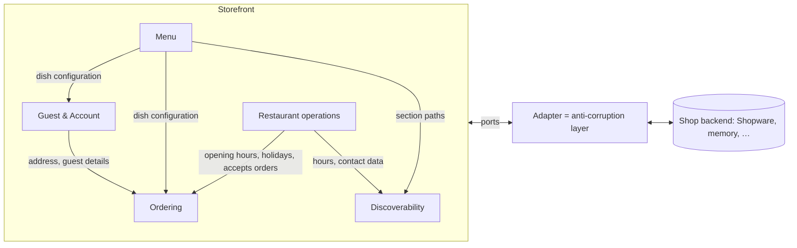

# 0001: Backend-agnostic storefront (ports and adapters behind a BFF)

## Context

The storefront is welded to Shopware. At 2.6.0 about 117 of 208 source files depend on it: `#shopware` types, the `@shopware/composables` layer and its auto-imported composables, `@shopware/api-client`, the generated `api-types`. 18 files call the Store API straight from the browser, and the server routes pass raw Shopware shapes (products, line items, SEO URLs) on to the app. A restaurant that runs another backend cannot use the storefront, and every Shopware upgrade reaches into components.

The storefront has its own rules that have nothing to do with Shopware: a dish with extras and removed ingredients is one cart line; wished times lie on a 5-minute grid within the opening hours, after the lead time of the chosen shipping method; holidays close the restaurant. Today these rules are spread over composables and depend on Shopware's data model.

## Decision

**The storefront works against any shop backend. Shopware becomes one adapter.**

### Backend for frontend

The browser talks only to the storefront's own Nitro routes (`/api/...`). No Store API call, access key or backend shape reaches the browser. The routes answer in the storefront's domain types (`shared/domain`).

The storefront keeps its own session behind an HttpOnly cookie. Whatever a backend needs to recognise a visitor (Shopware's `sw-context-token`, a Sylius cart token and JWT) is stored server-side in that session and is read and written only by the adapter, through `BackendSession` (`server/ports/session.ts`). Decided now, built in step 4.

### Ports and adapters

Ports are TypeScript interfaces in `server/ports/`, cut along ShopBite's language ([GLOSSARY.md](../../GLOSSARY.md)), not Shopware's:

| Port             | Context               | What it answers                                                        |
| ---------------- | --------------------- | ---------------------------------------------------------------------- |
| `CatalogPort`    | Menu                  | menu sections, dishes, variants, extras, search, top sellers, upsell   |
| `NavigationPort` | Discoverability       | navigations, breadcrumbs, path resolution with redirects, sitemap      |
| `CartPort`       | Ordering              | the cart, one line per dish configuration, vouchers                    |
| `CheckoutPort`   | Ordering              | shipping and payment methods, guest details, placing orders, payment   |
| `OrderPort`      | Ordering              | placed orders with the storefront's own order and payment status       |
| `CustomerPort`   | Guest & Account       | login, registration, profile, addresses, countries                     |
| `WishlistPort`   | Guest & Account       | the customer's wishlist of dish configurations                         |
| `ShopPort`       | Restaurant operations | configuration, opening hours, holidays, branches                       |
| `ContactPort`    | Restaurant operations | contact messages                                                       |

The ports live on the server because only the server talks to a backend and holds the session. The domain types live in `shared/domain/` so the app can type the BFF answers with them.

Two adapters in `server/adapters/`:

- `shopware`: today's behaviour over the Store API and the ShopBite plugin.
- `memory`: the whole backend in process memory, seeded with the quickstart's demo restaurant. It proves that the ports can be served without Shopware and backs the contract tests.

Runtime config `shopBite.backend` (`NUXT_SHOP_BITE_BACKEND`, default `shopware`) selects the adapter; server routes reach it with `useBackend(event)` (`server/utils/backend.ts`), one instance per process. Ports an adapter does not have yet reject with the domain error `not_implemented`.

Each port gets a contract suite in `test/contract/` that runs against every adapter (`runContract`). A suite describes a scenario in domain terms; each adapter fixture builds a backend holding it (the memory adapter from its seed, the Shopware adapter from a fake Store API answering Shopware JSON). Adapter-specific edge cases (what Shopware sends that the domain cannot express) are unit tests next to the adapter.

Caching, backoff and the resilient loaders stay in the server routes around the port calls, not in the adapters, so every adapter gets them and a contract test sees the adapter's own behaviour.

### Bounded contexts and context map

- **Menu**: what the restaurant offers.
- **Ordering**: cart, checkout, delivery or pickup, orders.
- **Guest & Account**: who orders; guests, customers, addresses, wishlist.
- **Restaurant operations**: opening hours, holidays, store status, branches, the switch that accepts orders, contact.
- **Discoverability**: paths, navigations, SEO, sitemap, `llms.txt`.
- **Shared kernel** (`shared/domain/kernel`): `Money`, `Media`, `TimeOfDay`, `CalendarDate`, `TimeZone`, `Weekday`, `Id`, `DomainError`.

Upstream contexts publish their types; downstream contexts use them as they are (customer/supplier inside one codebase). Every adapter is an anti-corruption layer: it translates the backend's model into the domain types in both directions, and no backend word passes it (the glossary lists the Shopware words that must not leak). The storefront's Markdown content pages are not a backend matter and stay outside the ports.

### Scope of DDD

- **Strategic DDD in full**: the glossary, the contexts, the context map, an anti-corruption layer per adapter.
- **Tactical DDD where the storefront owns the rule**: value objects as immutable types with validating constructors (`money`, `timeOfDay`, `calendarDate`, `timeZone`, `leadTime`, `wishedTime`, `openingInterval`, `holiday`, `dishConfiguration`), domain services as pure functions (e.g. `earliestWishedTime`; the ordering window and store status follow when their logic moves), domain errors with codes (`DomainError`).
- **Not** repositories or aggregates with persistence: the backend owns the state, ports are gateways that answer with the backend's result (a cart port returns the cart the backend calculated). **Not** domain events across contexts: the contexts share one process and call each other's pure functions.

Within this frame:

- IDs are opaque strings. Money is integer minor units with an ISO 4217 code; the number of minor digits comes from the currency (EUR 2, JPY 0, KWD 3, `Intl.NumberFormat`), decimals round half away from zero, and there is no negative zero (Sylius stores minor units; Shopware's decimals are converted at the adapter).
- Countries are ISO 3166-1 alpha-2 codes; the Shopware adapter maps them to country ids.
- **Time** belongs to the restaurant, not to the server or the browser: `ShopConfig.timeZone` (IANA). The ShopBite plugin decides in the sales channel's business time zone, else Europe/Berlin, but does not report it, so the Shopware adapter takes runtime config `shopBite.timeZone` (default `Europe/Berlin`). Dates and wall-clock times of an instant are read in that zone (`zonedDateTime`), also across DST switches.
- Times of day are minutes since midnight. An opening interval never crosses midnight and may close at 24:00 (1440, the end of the day); a late-night opening is two intervals. The Shopware adapter maps plugin rows by the plugin's rule: a closing time at or before the opening time runs into the next day and is split at midnight, closing at 00:00 or 24:00 is the end of the day. Rows it cannot read are logged and dropped.
- Holidays are whole days (`firstDay`, `lastDay`, both included) in the restaurant's time zone.
- A wished time is a service date plus a time on the 5-minute grid, so an order before midnight can be wished for after it. `earliestWishedTime` looks at today's and tomorrow's opening intervals and holidays, at most 24 hours ahead. It is a field of `Order` and `PlaceOrderCommand`; putting it into Shopware's customer comment ("Wunschlieferzeit: 18:40") is the Shopware adapter's job.
- A cart has discounts, each with the voucher code it came from or none (an automatic discount).
- Adapters answer frozen values and build themselves from the runtime config (`shopwareFromRuntimeConfig`, `memoryFromRuntimeConfig`); the registry only picks one by name.
- Building a `srcset` from `Media` is presentation and lives in app utils, not in the domain.
- Visitor-specific ports take a `BackendSession`; shop-wide ports (catalog, navigation, shop, contact) take none, so their answers can be cached across visitors.
- The app imports types only from `shared/domain` for now: a value import of `shared/` from app code broke the Nitro server bundle of shops in 2.0.1. The first step that needs a value object in the app checks it with the layer build (`pnpm nuxt build test/layer`) first.

### Migration

Each step moves one area behind its port, keeps the shop working, and ships as a 2.x minor. Within a step, the old route or composable is replaced, not duplicated.

| Step | Area                                                                                                         | Release |
| ---- | ------------------------------------------------------------------------------------------------------------ | ------- |
| 0    | Glossary, this ADR, domain types and value objects, port interfaces, adapter registry, contract harness, lint guard; no behaviour change | 2.x minor |
| 1    | Restaurant operations: `ShopPort` (config, hours, holidays, branches) behind the BFF, live checkout switch through the BFF | 2.x minor |
| 2    | Menu: `CatalogPort` (sections, dishes, variants, extras, search, top sellers); memory adapter gets the demo menu | 2.x minor |
| 3    | Discoverability: `NavigationPort` (navigations, path resolution and redirects, sitemap, `llms.txt`)          | 2.x minor |
| 4    | Storefront session (HttpOnly cookie, backend state server-side) and `CartPort`                                 | 2.x minor |
| 5    | Checkout and orders: `CheckoutPort`, `OrderPort` (wished time, guest details, payment)                        | 2.x minor |
| 6    | Guest & Account: `CustomerPort` (login, registration, profile, addresses)                                    | 2.x minor |
| 7    | `WishlistPort`, `ContactPort`; no browser-direct backend call left                                           | 2.x minor |
| 8    | Remove `@shopware/nuxt-module`, the `@shopware/composables` layer and the Shopware helpers outside the adapter; the lint guard becomes an error | 3.0.0 |

### Progress

**Step 1 (restaurant operations), done.** `ShopPort` and `CheckoutPort.listShippingMethods` behind the BFF: `GET /api/shop/config`, `/api/shop/opening-hours`, `/api/shop/holidays`, `/api/shop/branches`, `/api/checkout/shipping-methods` answer domain types; they replace `/api/shopbite/config`, `/business-hours` and `/holidays`. Each is cached for server-side rendering and `llms.txt` (`server/utils/shopData.ts`, `swr: false`, resilient loader, emptied by every purge and by `{ "layout": true }`); `?fresh=1` asks the port directly (no cache, no last good answer) for the browser's live values and for the check of the switch that accepts orders right before an order. `DomainError`s become HTTP answers in one place (`server/utils/domainHttp.ts`). The browser asks no Store API for configuration, hours, holidays, branches, lead times or the menu root (`/api/menu/root`). Store status, opening hours displays, the wished time choice, the Restaurant schema and `llms.txt` work in the restaurant's time zone, and a late-night opening reads and counts as one span (Fri 17:00–01:30). Lint guard: 105 warnings (111 at step 0).

Deviations and open points of step 1:

- The app does not use the domain's value objects and services (`earliestWishedTime`): a value import from `shared/` is still avoided in app code. `app/utils/restaurantTime.ts` computes store status and the wished time window on the domain types; it moves onto the domain services together with the ordering window.
- Ordering window vs. plugin (note below): settled for now on the plugin's side. The wished time stays within today's spans plus yesterday's late-night span, never on a holiday, and no pre-order for a later service day is offered. A late-night opening that started on a holiday is not continued after midnight (the display joins the split intervals and keeps their origin day). DST slots are not treated specially (wall-clock minutes).
- Lead times are live in the browser like the switch (`useLiveShopData`, the checkout every 10 s); the Shopware adapter needs two Store API requests for them (plugin config and `/shipping-method` names).
- The menu root still comes from the Shopware plugin config on the server (`shopbite-config`, a second cache of `/shopbite/config` next to `shop-config`) until `NavigationPort` (step 3).
- Behaviour changes allowed by the step: holidays are whole days in the restaurant's time zone (the Restaurant schema and `llms.txt` took the UTC date of the plugin's instants before); an interval up to the end of the day reads `24:00` instead of `00:00` (schema.org keeps `00:00`, a day open around the clock is `00:00`–`23:59`).

### Lint guard

`@typescript-eslint/no-restricted-imports` forbids `#shopware`, `@shopware/*` and the `api-types` (`~~/api-types/*`, relative paths) outside `server/adapters/shopware/**`, the generated types and `shopware.d.ts`. It warns during steps 1 to 7 (111 warnings in 103 files at step 0, the number to bring down) and becomes an error in step 8. `#shopware/*` subpaths are covered too. It sees static `import` and `export … from` only: not type queries (`typeof import("#shopware")`, `import("…").Type` in a type position), not dynamic `import()`, and not composables auto-imported from the Shopware layer (`useShopwareContext`, `useCart`, …). Those disappear with the layer in step 8, and the typecheck finds what is left.

## Consequences

- During steps 1 to 7 two paths coexist: moved areas go browser → BFF → port → adapter, the rest still uses the Shopware composables. Each step's PR says which.
- Cart and checkout actions get one more hop (browser → Nitro → backend); the BFF can batch and cache shop-wide answers, and the access key and context token leave the browser, which removes them from the reach of injected scripts.
- Values that gate an order and are cached for rendering today (the checkout switch, hours, holidays; the browser reloads them from Shopware after hydration) have to stay fresh through the BFF: an uncached or short-lived route for the browser, the cached one for SSR.
- Shops that override Shopware composables of the layer have to move to the ports by 3.0.0; the 2.x releases keep their overrides working.
- A new backend means a new folder in `server/adapters/` that passes the contract suites, plus a value of `shopBite.backend`. The memory adapter can later run e2e and a11y tests without a Shopware instance.

## Notes for later steps

Recommendations from the review of step 0, to settle when the area moves:

- **Ordering window vs. the ShopBite plugin (settle before the UI uses `earliestWishedTime`, step 1 or 4).**
  - *Pre-orders for the next day:* at 23:30 the domain offers 11:30 of the next day, but the plugin's ordering window only looks at yesterday's and today's intervals and refuses such an order at checkout. Either the plugin accepts orders for a later service date, or the storefront limits wished times to the plugin's window.
  - *Overnight interval after a holiday:* the plugin ignores the after-midnight part of an interval that started on a holiday; splitting rows into weekday intervals loses that origin, so the domain treats it as open. Keep the origin day of a split interval (or apply the holiday to the continuation) when this matters.
  - *DST:* a wished time can land in the spring-forward gap or the ambiguous fall-back hour, and the 24 h search limit is wall-clock time. Decide whether to skip such slots.

- **Catalog (step 2)**: `DishDetail` names the selected variant when opened by a variant's number; `Variant` gets its own name, media and main ingredients; an `Extra` can be unavailable; main ingredients get ids (removals by id, names only for display); list and strike-through prices.
- **Cart (step 4)**: a structured variant label instead of one name string; removed ingredients are part of a line's identity, so two configurations that differ only in removals stay two lines (Shopware's container key today hashes dish and extras only); taxes as gross or net; subtotals before and after discounts.
- **Checkout (step 1 and 5)**: `listShippingMethods` takes an optional session (Sylius prices shipping per cart; in the port since step 1, unused by both adapters). It is implemented in step 1 already, because ShopPort's consumers (home page, `llms.txt`, the time choice) need the lead times. Guest details stay editable after `registerGuest`.
- **Orders (step 5)**: a guest opens an order by an e-mail deep link or token, without an account; `OrderLine` carries its `DishConfiguration` so an order can be repeated.
- **BFF (step 1, done)**: one shared mapper from `DomainError` codes to HTTP answers for all routes (`server/utils/domainHttp.ts`).
- **Session (step 4)**: the backend token can rotate (login, logout) while parallel requests of the same visitor are in flight; writes to the session must not lose a newer token.

## Sylius as a sanity check

Not built; the port shapes were checked against how Sylius (2.x, API Platform shop API) would serve them:

- **The hardest mapping: a dish with extras and removed ingredients as one cart line.** The ports model it as a `CartLine` with a `DishConfiguration` (dish or variant, extras, removed ingredients), priced as a whole, never as Shopware's `container` line item with children. Sylius has no such line: an order item is one variant, and two items with the same variant merge (`OrderItem::equals`). A Sylius adapter needs a plugin that stores the configuration on the order item, compares items by configuration, and prices extras as adjustments (or as child units). The port does not change.
- Menu sections are taxons, dishes are products, variants are product variants with option values (`VariantGroup` = product option), extra groups are product associations. Main ingredients, diets and allergens are product attributes.
- Money is already integer minor units, countries are codes, there are no salutation entities (hence nullable `Salutation`).
- Paths come from taxon slugs; Sylius keeps no history of old slugs, so `resolvePath` answers fewer redirects. The port allows that.
- The visitor's cart token and the shop user's JWT go into the storefront session as the adapter's opaque state, like Shopware's context token.
- Order states (`new`, `fulfilled`, `cancelled`), payment states and shipping states map onto `OrderStatus` and `PaymentStatus`.
- Opening hours, holidays, lead time per shipping method, the switch that accepts orders and the wished time have no Sylius counterpart; they come from a plugin (or from the storefront's own configuration). `ShopPort` and `ShippingMethod.leadTime` do not assume Shopware entities.
- Branches are channels; a channel per branch with its own hostname.
